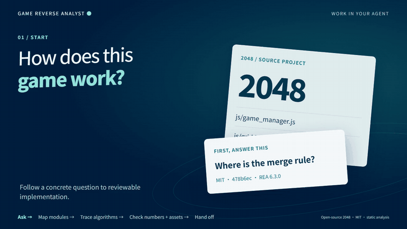
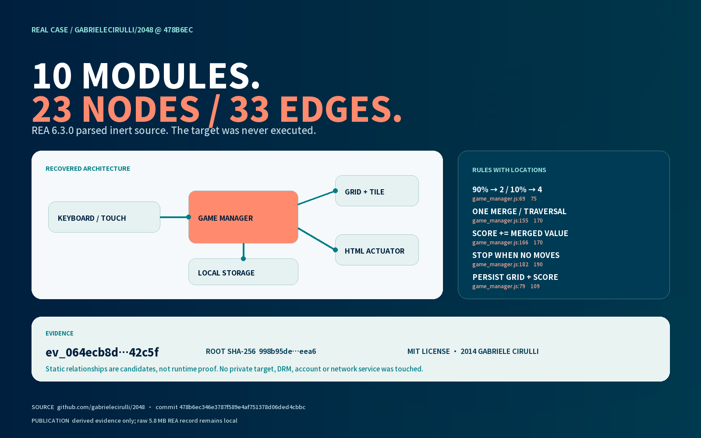

# Game Reverse Analyst

[中文](README.md)

<picture>
  <source media="(prefers-reduced-motion: reduce)" srcset="assets/readme/hero-en.png">
  
</picture>

With explicit authority, use observation, REA, and appropriate asset tools to understand mechanics, architecture, rules, balance, and asset structure. Produce an analysis package with evidence, hashes, coverage, and limitations for game designers, engineers, Art Directors, and production managers.

[30-second start](docs/HUMAN-GUIDE.en.md) · [Agent guide](docs/AGENT-GUIDE.en.md) · [Read the canonical skill](SKILL.md) · [REA integration](references/rea-integration.md) · [Real case](case-studies/2048-open-source/README.en.md) · [Darwin review](evals/darwin-review.md)

  

## Completed real case

The [open-source 2048 analysis](case-studies/2048-open-source/README.en.md) pins an exact commit and statically analyzes ten JavaScript modules with REA 6.3.0. The target was never executed. The public case includes architecture, rule locations, input hashes, an evidence ID, and limitations; the complete 5.8 MB analysis record remains local.

[](case-studies/2048-open-source/dashboard-en.png)

## Start now

```text
git clone https://github.com/NewenergyEric/game-reverse-analyst.git
cd game-reverse-analyst
npm ci --ignore-scripts
python scripts/rea_bridge.py check
python scripts/rea_bridge.py analyze-js examples/merge-fixture --out outputs/demo-analysis
```

Ask an agent with GitHub or local-file access to read `SKILL.md` first and freeze the target version, authority, scope, and research question. REA is pinned in `package-lock.json`; see `package.json` for the Node requirement.

## Five analysis layers

| Layer | Output |
|---|---|
| Mechanics and experience | Core loop, input, state, feedback, progression, and content cadence |
| Technical architecture | Modules, calls, data, resource loading, engine/native boundaries, and network clues |
| Balance and rules | Configuration, functions, applicable inputs, unknown branches, and validation paths |
| Art and content assets | Categories, families, bases, variants, states, specifications, and composition |
| Transferable structure and uncertainty | Structures we can study, content that must be original, coverage gaps, and next steps |

## Role handoffs

| Role | Delivery |
|---|---|
| [Game Market Intelligence Director](https://github.com/NewenergyEric/game-market-intelligence) | Market evidence, competitor scope, and business questions |
| Game Reverse Analyst | Mechanics, architecture, asset breakdown, BOM, evidence, and unknowns |
| [Game Production Manager](https://github.com/NewenergyEric/game-production-manager) | Turn confirmed direction into SOW, tasks, and acceptance |
| [Art Director](https://github.com/NewenergyEric/art-director-skill) | Turn art observations into standards, families, and exemplars |

## Boundaries

A successful REA startup or JavaScript fixture analysis does not prove complete analysis of an APK, .NET or native program, or any commercial game. Static strings do not prove server implementation. An asset inventory is not a production estimate and does not grant redistribution rights.

Analyze only material you are authorized to use. Do not bypass DRM, payments, credentials, access controls, or online services. When authority or provenance is unclear, document the gap and stop deeper analysis.

Run `python -m unittest discover -s tests -v` to validate the bridge. Original fixtures, Darwin prompts, and verified scope live in [`evals/`](evals/); project comparisons are in the [GitHub reference scan](references/github-reference-scan.md). Raw targets, full analysis outputs, and credentials stay in the user's private workspace.

MIT licensed. REA dependencies and case-study source retain their own licenses.
