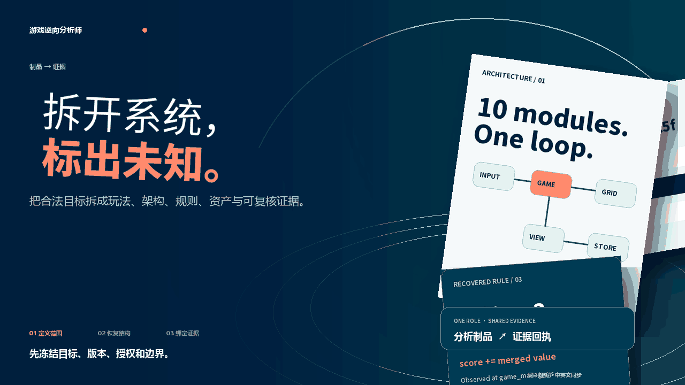
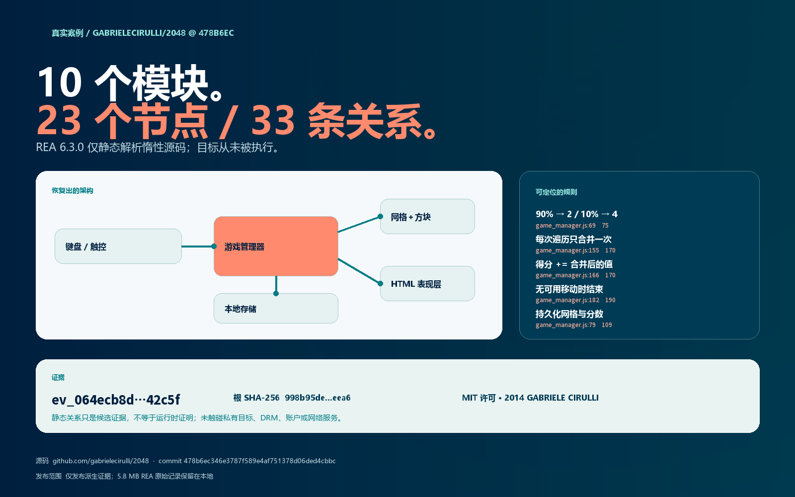

# 游戏拆解与逆向分析师

[English](README.en.md)

<picture>
  <source media="(prefers-reduced-motion: reduce)" srcset="assets/readme/hero-zh.png">
  
</picture>

在拥有授权的前提下，用观察、REA 和适配的资产工具理解游戏的玩法、架构、规则、数值和资产结构。输出带证据、哈希、覆盖范围和局限的拆解包，供策划、程序、Art Director 和项目经理继续工作。

[30 秒开始](docs/HUMAN-GUIDE.md) · [Agent 调用说明](docs/AGENT-GUIDE.md) · [读取 Skill](SKILL.md) · [REA 接入](references/rea-integration.md) · [真实案例](case-studies/2048-open-source/README.md) · [Darwin 审查](evals/darwin-review.md)

  

## 已完成的真实案例

[2048 开源源码拆解](case-studies/2048-open-source/README.md)固定到明确 commit，用 REA 6.3.0 静态分析 10 个 JavaScript 模块；目标未被执行。公开案例给出架构、规则位置、输入哈希、证据 ID 和局限，原始 5.8 MB 分析记录保留在本地。

[](case-studies/2048-open-source/dashboard-zh.png)

## 立即使用

```text
git clone https://github.com/NewenergyEric/game-reverse-analyst.git
cd game-reverse-analyst
npm ci --ignore-scripts
python scripts/rea_bridge.py check
python scripts/rea_bridge.py analyze-js examples/merge-fixture --out outputs/demo-analysis
```

把仓库交给能读取 GitHub 或本地文件的 Agent，要求它先读 `SKILL.md` 并固定目标版本、授权范围和研究问题。REA 当前锁定在 `package-lock.json`；Node 版本要求见 `package.json`。

## 五层拆解

| 层 | 输出 |
|---|---|
| 玩法与体验 | 核心循环、输入、状态、反馈、成长和内容节奏 |
| 技术架构 | 模块、调用、数据、资源加载、引擎／原生边界和网络线索 |
| 数值与规则 | 配置、函数、适用输入、未知分支和验证路径 |
| 美术与内容资产 | 分类、家族、基础件、变体、状态、规格和组合关系 |
| 可借鉴与不确定性 | 我方可研究结构、需要原创的内容、覆盖缺口和下一步 |

## 岗位协作

| 岗位 | 交付 |
|---|---|
| [游戏市场研究总监](https://github.com/NewenergyEric/game-market-intelligence) | 市场证据、竞品范围和经营问题 |
| 游戏拆解与逆向分析师 | 玩法／架构／资产拆解、BOM、证据和未知 |
| [游戏制作项目经理](https://github.com/NewenergyEric/game-production-manager) | 将确认后的方向转为 SOW、任务和验收 |
| [美术总监](https://github.com/NewenergyEric/art-director-skill) | 将美术观察转为规范、家族和样板 |

## 重要边界

REA 可启动或某个 JS fixture 分析成功，不代表 APK、.NET、原生程序或任何商业游戏都能完整逆向。静态字符串不证明服务端实现；资产清单不等于制作工时，更不代表可以再分发原始素材。

仅分析合法可用资料。不绕过 DRM、支付、凭据、访问控制或在线服务；没有授权或来源不明时，输出范围与合规缺口并停止深度分析。

运行 `python -m unittest discover -s tests -v` 验证桥接层。REA 原创样例、Darwin prompts、边界反馈和真实验证范围见 [`evals/`](evals/)；同类项目取舍见 [GitHub 参考扫描](references/github-reference-scan.md)。原始目标、完整分析输出和账号配置留在使用者的私有工作区。

本仓库使用 MIT；REA 依赖与案例源码保留各自许可证。
